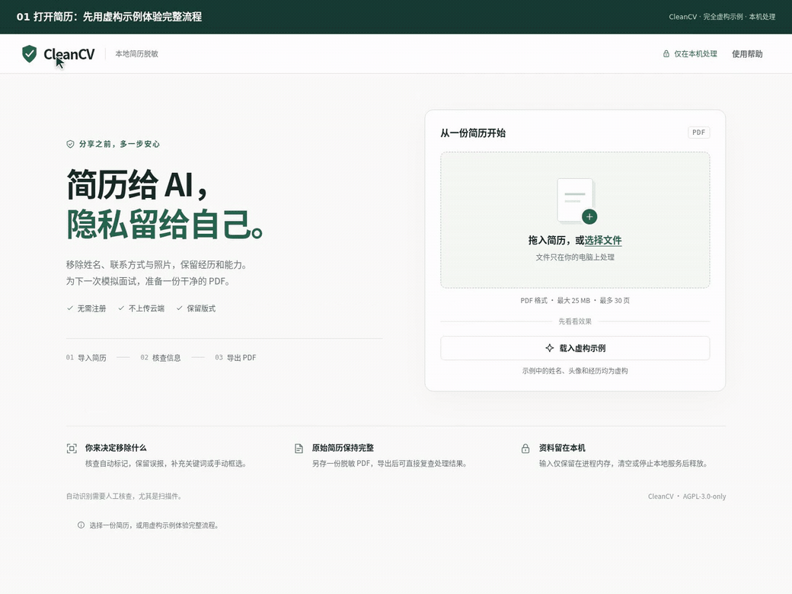

<p align="center">
  
</p>
<h1 align="center">CleanCV</h1>
<p align="center"><strong>把简历交给 AI 之前，先在本机移除个人信息。</strong></p>
<p align="center">Local-first resume redaction for AI interview practice.</p>
<p align="center">
  <a href="#操作演示">操作演示</a> ·
  <a href="#快速开始">快速开始</a> ·
  <a href="docs/usage.md">使用手册</a> ·
  <a href="#隐私边界">隐私边界</a>
</p>
<p align="center">
  <a href="https://github.com/MRT-8/CleanCV/actions/workflows/tests.yml"></a>
</p>

CleanCV 是一个本地运行的 PDF 简历脱敏工具。自动标出姓名、电话、邮箱、政治身份和照片候选，允许你撤销误报、补充文字和拖动框选，最后生成新的 PDF 并预览处理结果。

**本机处理 · 无云端 API · 可视化核查 · 网页与命令行**

## 操作演示



<p align="center">
  <a href="docs/media/cleancv-demo.mp4"><strong>播放高清 MP4</strong></a> ·
  <a href="docs/media/cleancv-home.png">导入首页</a> ·
  <a href="docs/media/cleancv-poster.png">核查工作区</a> ·
  <a href="docs/demo.md">演示素材与复现</a>
</p>

> 录屏操作真实运行的 CleanCV。姓名、联系方式、头像、学校、城市和项目全部来自代码生成的虚构示例，没有使用真实简历、照片或浏览器个人配置。

建议按以下顺序操作：

1. **打开简历**：选择或拖入自己的 PDF，或点击“载入虚构示例”。
2. **核查自动候选**：逐页检查红框，点击 **×** 撤销误报。
3. **补充遗漏信息**：填写额外词，或直接拖动框选所在地、个人标识等内容。
4. **导出并复查**：勾选已核查，生成 PDF，在结果预览中再次检查后再分享。

新版界面分为导入首页、全屏核查和结果复查三个状态。核查区支持页码缩略图、候选定位和缩放，手机端可切换预览与核查面板。设计参考与操作说明见 [界面设计](docs/design.md)。

## 你可以做什么

| 功能 | 用法 |
|---|---|
| 自动定位 | 姓名候选、常见电话与邮箱、政治身份、页首照片候选 |
| 人工决定 | 点击候选类别定位、保留误报、补充关键词和手动框选 |
| 多页导航 | 页码缩略图、页码跳转、画布缩放 |
| 结果预览 | 导出后直接查看处理结果，也可以返回原稿继续编辑 |
| 本地处理 | 输入与结果保留在本机进程内存，清空或停止本地服务后释放 |
| 命令行批处理 | 使用明确姓名、额外词、手动区域或绑定输入的区域计划 |
| 可选 OCR | 在本机对已经脱敏的画面识别文字，不使用外部 OCR 服务 |

## 快速开始

需要 Python 3.10+。

```bash
git clone https://github.com/MRT-8/CleanCV.git
cd CleanCV
python -m pip install -e .
cleancv serve --open-browser
```

推荐在自己的虚拟环境中安装。已经安装 PyMuPDF 时，也可以直接运行：

```bash
python3 run.py
```

打开终端输出的完整本地链接。服务只监听 `127.0.0.1`；随机会话令牌用于保护本机接口，不需要注册或配置 API Key。

命令行示例：

```bash
cleancv scan input.pdf
cleancv clean input.pdf -o resume-anonymized.pdf
```

明确姓名、额外词、扫描件、照片模式、页码坐标及本地 OCR 的完整用法，见 [使用手册](docs/usage.md)。默认不覆盖原文件，也不覆盖已有输出。

## 输出是什么？

CleanCV 先保留输入的可见外观，再应用 redaction，并根据已经处理的页面画面建立全新 PDF。原文件的文字层、图片对象、隐藏评论、附件、链接和元数据不会复制到输出中。

**默认输出是图片型 PDF**：版式仍在，但不能选中文字。AI 工具需要支持 PDF 图像理解或 OCR；如需可复制文字，可使用[可选本地 OCR](docs/usage.md#输出为什么默认不能复制文字)。

## 隐私边界

- 自动识别可能误报或漏报。**导出前后都要逐页核查**，扫描件尤其需要手动框选。
- 学校、论文题目、项目链接等仍可能关联身份，可继续使用额外词和框选移除。
- 姓名和照片检测使用启发式规则，不推断真实身份，不做人脸识别。
- 网页不使用第三方脚本、字体或统计服务。浏览器、系统交换文件及下载目录不在应用控制范围内。
- 命令行个人参数可能进入 shell 历史或进程列表；不希望留下这些值时，使用本地网页。
- 仓库默认忽略真实 PDF、照片和 `private/`。演示媒体仅放行明确命名、经过复查的虚构素材。

## 开发会话（Codex）

本项目的需求、隐私约束、实现与界面重构讨论记录在以下会话中。后续修改前，可先回看该会话。

- 会话 ID：`01a20e40-1feb-7032-b8c2-3604b3248fd0`
- 在保留该会话历史的 Codex 环境中恢复：

```bash
codex resume 01a20e40-1feb-7032-b8c2-3604b3248fd0
```

此处仅记录会话 ID，不包含聊天正文；需要在原有历史记录可用的环境中查看。

## 开发

```bash
python -m pip install -e '.[test]'
python -m pytest -q
```

测试包括脱敏重建、旋转页、扫描件、表单、既有遮挡批注、原文件保护，以及本地接口认证和文档隔离。真实浏览器录制脚本也会核查完整操作流程，详见 [演示复现说明](docs/demo.md)。

## License

[AGPL-3.0-only](LICENSE)。PDF 处理依赖 [PyMuPDF](https://github.com/pymupdf/PyMuPDF)。本项目按原样提供，不附带担保。
